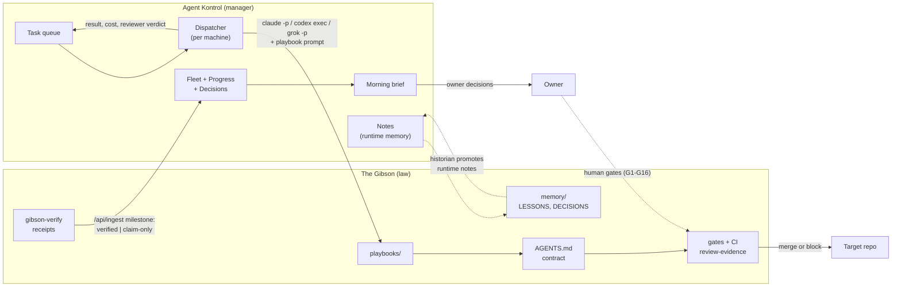

# 31 — The Gibson and Agent Kontrol: Law and Manager

> **Authority:** Non-normative. Explanation, rationale, and history only. Binding commit/PR/merge rules live in [`AGENTS.md`](../AGENTS.md). This file must not add, drop, or weaken those rules.

> 🙂 **In plain English:** The Gibson is the rulebook and the gates. Agent Kontrol is
> the manager that hands out work, watches who is doing what, and tells you each
> morning what is stuck and what needs your decision. The manager never overrules the
> rulebook: a task can be queued, claimed and reported by Agent Kontrol, but only the
> Gibson's checks decide whether the work may merge.

**Status:** Describes the pairing as of 2026-10-25. Agent Kontrol is the renamed
**Mission Control**; see [What changed in the name](#what-changed-in-the-name).

## The split

| | The Gibson (this repo) | Agent Kontrol |
|---|---|---|
| **One line** | The law: how agents work | The manager: who works, on what, and is it moving |
| **Lives in** | Markdown contract, scripts, CI templates, `memory/` | A running service: dashboard, REST API, MCP server, Postgres |
| **Decides** | Whether a change may merge (tiers, gates, review evidence, human gates) | Which task is queued, which machine and platform claims it, what is stuck |
| **Is deterministic about** | Gates that do not care who wrote the code | Liveness from hooks and watchers, not from agents remembering to report |
| **Owns state that outlives a task** | `memory/` lessons, decisions, incidents (git, reviewed) | Nothing durable by design; its notes table is short-lived coordination |
| **Cannot do** | Dispatch work or show a fleet view | Authorize a merge, waive a gate, or change a Tier |
| **Repo** | [The-AIE/the-gibson](https://github.com/The-AIE/the-gibson) | [mrhinkle/agent-kontrol](https://github.com/mrhinkle/agent-kontrol) |

Either can run alone with reduced power. A fleet with only the Gibson has rules and
gates but no queue, no fleet view and no morning brief. A fleet with only Agent
Kontrol has dispatch and dashboards but no contract, so nothing stops an agent from
grading its own work.

## How they fit



The direction of authority is one-way. Agent Kontrol **sends work into** the
Gibson's pipeline and **reads outcomes out of** it. Nothing flows back from Agent
Kontrol that a gate treats as evidence.

## The hand-off points

Each row is a place where the two systems touch, what crosses, and which side is
authoritative.

| Hand-off | What crosses | Authoritative side |
|---|---|---|
| **Dispatch** | A queued task carries an issue number, a target repo and a platform. The dispatcher runs the agent CLI headless in the repo's working directory with the role's playbook as the prompt ([`playbooks/builder.md`](../playbooks/builder.md): "dispatch with the issue number and target repo path"). | Gibson (the playbook and `AGENTS.md` the agent loads). Agent Kontrol only routes. |
| **Session start** | Before starting, the agent recalls fleet memory (Agent Kontrol `recall`, or `memory/` grep) so it does not redo or double-claim work ([`AGENTS.md`](../AGENTS.md) session-start step 4). | Either; it is a lookup, not a rule. |
| **Claims** | The Gibson's per-repo claim protocol ([docs/05](05-concurrency.md)) and Agent Kontrol's atomic task claim are two systems. The dispatched agent's first act is the Gibson claim; a claim conflict re-queues the task. | Gibson for repo lanes (max 3 mutating lanes per repo). Agent Kontrol for which dispatcher wins a task row. |
| **Liveness** | Hooks, watchers and the dispatcher post to `/api/ingest`. The Gibson's [liveness contract](liveness-contract.md) requires agents to emit progress on a cadence; silence reads as a stall. | Agent Kontrol displays it; the liveness contract defines what an agent must emit. |
| **Truthful status** | Law 8: status goes to the queue (Agent Kontrol) and the PR, failures verbatim, skipped steps named. | Gibson (`scripts/truthful-status.mjs`). |
| **Verification receipts** | `scripts/gibson-verify.mjs report` posts a `milestone` event with `detail.status` of `verified` or `claim-only`, bound to a head SHA ([docs/30](30-verification-lever.md)). | Gibson produces; Agent Kontrol only displays. A receipt never authorizes a merge. |
| **Cross-vendor review** | A task can name a `reviewer_platform`, and the dispatcher runs that second platform read-only. This is the dispatch-side half of "whoever wrote it does not review it". | Gibson. The merge gate reads `review-evidence` on the exact head SHA; a dispatcher verdict alone is not review evidence. |
| **Memory** | `remember` / `recall` hold runtime coordination. Anything that should still matter in a month is promoted into `memory/` by the historian ([docs/09](09-memory-and-self-improvement.md)). | Gibson `memory/` is durable; Agent Kontrol notes are not. |
| **Cost** | The dispatcher records `cost_usd` per task. The historian reads it for the weekly cost-per-merged-PR number ([docs/15](15-model-economics.md)). | Agent Kontrol records; the Gibson interprets. |
| **Owner decisions** | Human gates fire inside the Gibson ([docs/14](14-human-gates.md)). Agent Kontrol collects open owner decisions (by GitHub label or MCP) into one queue with ages, and pushes a morning brief. | Gibson defines *which* decisions need a human. Agent Kontrol surfaces them. |

## Roles across the two

Agent Kontrol's [roles page](https://github.com/mrhinkle/agent-kontrol/blob/main/docs/ROLES.md)
describes the staffing view (Spec Writer, Implementer, Reviewer, Dispatcher, Owner).
The Gibson's contracts in [`AGENTS.md`](../AGENTS.md) and
[docs/03](03-roles.md) are the binding view. They map as:

| Agent Kontrol job | Gibson role(s) |
|---|---|
| Spec Writer | `planner` + `decomposer` |
| Implementer | `builder` (and `test-engineer` where the spec demands new tests) |
| Reviewer | `reviewer`, plus `security` and `ux-evaluator` lenses on the tiers that require them |
| Dispatcher | `release` and delivery-control (the merge and promote half) and the claim loop in [`playbooks/loop-step.md`](../playbooks/loop-step.md); Agent Kontrol's per-machine dispatcher is the reference implementation |
| Owner | The human who holds the G1–G16 gates |

If the two ever disagree about a job, `AGENTS.md` wins. Agent Kontrol's role cards
explain the jobs and how to staff them; they do not add or weaken a gate.

## Setting up the pair

1. **Stand up Agent Kontrol** with its [deploy guide](https://github.com/mrhinkle/agent-kontrol/blob/main/docs/DEPLOY.md).
   It needs `MC_TOKEN` (the shared secret agents use) and `MC_DASHBOARD_PASSWORD`.
2. **Adopt the Gibson** in each target repo ([docs/13](13-adoption.md),
   [`playbooks/adopt.md`](../playbooks/adopt.md)), then register the repo in Agent
   Kontrol (project name, working directory on each machine).
3. **Connect each runtime.** Claude Code uses lifecycle hooks; Codex a session
   watcher; Grok and Hermes use MCP plus a heartbeat. Per-runtime detail lives in
   [`adapters/`](../adapters/README.md) and in Agent Kontrol's
   [agents guide](https://github.com/mrhinkle/agent-kontrol/blob/main/docs/AGENTS.md).
4. **Start a dispatcher** on each machine that should take queued work.
5. **Set the environment** where a Gibson script needs to report:

   | Variable | Used by | Meaning |
   |---|---|---|
   | `MC_URL` | `scripts/gibson-verify.mjs report` | Base URL of the Agent Kontrol deployment |
   | `MC_TOKEN` | `scripts/gibson-verify.mjs report`, the dispatcher, hooks | Bearer token for ingest and the MCP endpoint |

   The values are never printed. `report` fails closed if either is unset.
6. **Prove it end to end before trusting it.** From a target repo:

   ```bash
   node /path/to/the-gibson/scripts/gibson-verify.mjs doctor --repo .
   node /path/to/the-gibson/scripts/gibson-verify.mjs report --agent my-agent --dry-run
   ```

   Then run `report` without `--dry-run` and confirm the milestone shows on the
   fleet page. `report` exits 1 when Agent Kontrol answers `{ok: true, demo: true}`,
   which means it has no database and dropped the event.

## What it deliberately does not do

- **No merge authority.** Agent Kontrol output (a task marked `done`, a reviewer
  verdict, a `verified` milestone) is never accepted by a gate in place of CI or
  `review-evidence`. If it could be, an agent could mark its own task done and
  merge.
- **No Gibson rules in Agent Kontrol, no fleet state in the Gibson.** Gates, tiers
  and human gates change only through a PR here. Queue contents, liveness and cost
  live only in Agent Kontrol and are not committed to this repo.
- **No heartbeat-as-proof.** A running process proves nothing about work. The
  coordinator was once found paused for two days while its heartbeat kept posting;
  liveness is measured by output, and the brief reports last *work* event.
- **Known seam.** The task queue and the Gibson's repo claims are still separate
  systems ([docs/05](05-concurrency.md#lane-limits)). Until the dispatcher
  understands repo claims, the dispatched agent claims first and a conflict
  re-queues.

## What changed in the name

Agent Kontrol is the former **Mission Control**. The product, repository
(`mrhinkle/agent-kontrol`) and documentation use the new name. Some identifiers
inside Agent Kontrol were **not** renamed, so you will still
meet the old prefix in configuration:

| Still named | Where |
|---|---|
| `MC_URL`, `MC_TOKEN`, `MC_POLL_SECONDS`, `MC_WORKDIR`, `MC_PLATFORMS` | Environment variables for scripts, hooks and the dispatcher |
| `~/.mission-control/` and `mc_dispatcher.py` | The dispatcher's state directory and entry point |
| `com.mission-control.dispatcher` | The launchd label in the dispatcher's example plist |
| "Mission Control" | Historical entries in `memory/LESSONS.md` and `memory/DECISIONS.md`, which are append-only records and are not rewritten |

Searching old issues, lessons or commits for "Mission Control" will find the same
system. In prose, the glossary abbreviation is **AK**.

## Further reading

- Agent Kontrol: [README](https://github.com/mrhinkle/agent-kontrol#readme),
  [MCP tools](https://github.com/mrhinkle/agent-kontrol/blob/main/docs/MCP.md),
  [REST API](https://github.com/mrhinkle/agent-kontrol/blob/main/docs/API.md),
  [Velocity: the morning brief and decision queue](https://github.com/mrhinkle/agent-kontrol/blob/main/docs/VELOCITY.md)
- Here: [docs/10 vendor adapters](10-vendor-adapters.md),
  [docs/30 verification lever](30-verification-lever.md),
  [docs/09 memory](09-memory-and-self-improvement.md),
  [docs/24 agent memory conventions](24-agent-memory-conventions.md)
