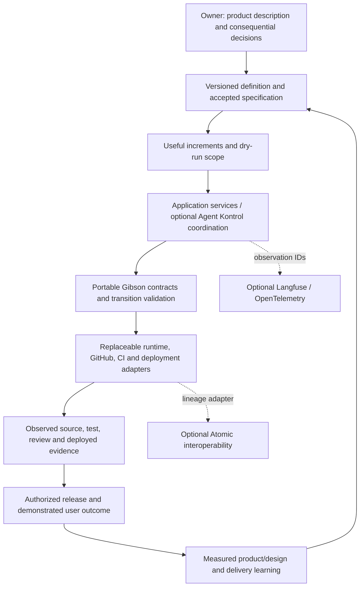

> **Authority:** Non-normative research proposal. Binding behavior remains in AGENTS.md; this document adds no gate, permission or deployed capability.

# Proposed reference architecture

This is a product/design proposal within the existing [#165 architecture direction](https://github.com/The-AIE/the-gibson/issues/165), not a second operational authority.

## User-facing path

An owner describes a product, reviews a readable specification and explicit unknowns, sees the next useful increment, answers consequential decisions, and receives the running result plus its evidence and limits.

Existing chat and Markdown can provide the first version. An integrated Agent Kontrol workbench can later project the same artifacts; a new UI is not required merely to prove the chain.

The diagram states intended responsibilities. It does not claim the entire path is shipped or live.

## Canonical homes and authority

| Fact | Canonical home | Projection |
|---|---|---|
| Product intent, requirement versions, assumptions and accepted scope | Versioned repository artifacts with recorded decisions | Owner/spec UI and research packet |
| Tasks, active attempts and coordination | Existing runtime/task store, with durable identity | Progress/queue view |
| Source and code-review target | Source control and exact commit/change identity | Workbench/evidence view |
| Check results and independent reviewer evidence | The actual trusted check/review source | Receipt/read model |
| Deployment identity and running behavior | Deployment platform and independently driven evaluation | Release/outcome view |
| Permission or owner decision | Explicit applicable authority and bounded decision reference | Decision card |
| AI telemetry | Selected observation backend | Linked diagnostics/experiments |

No projection becomes authority by being convenient. An agent narrative, dashboard badge or model rating cannot manufacture missing observations. A product-scope acceptance is not blanket permission for purchases, external messages, credentials or production changes.

## Minimal artifact chain

Use readable files with small structured indexes before inventing a language. The proposed references are design examples, not registered production schemas.

- Product definition: audience, problem/outcome, constraints, assumptions, explicit non-goals and open decisions.
- Specification version: stable requirement IDs, scenarios, product/architecture choices, assurance applicability and acceptance record.
- Increment: independently useful outcome, included/deferred requirements, dependencies, scope, rollout/recovery and evidence needed.
- Work reference: existing issue/claim/branch/PR and allowed surfaces; do not create another ownership protocol.
- Attempt/evidence: actual actor/provider/model where applicable, environment and commands, source/diff identity, observations, reviewer identity and limitations.
- Release/outcome: artifact/deployment identity, applicable permission, smoke/user-flow results, known gaps and the follow-up measurement.

A small reference can connect these artifacts without a mandatory graph database. More detailed schemas should reuse existing #160/#166/#167 seams after their current implementation is refreshed.

## Versioning and change impact

A material requirement keeps its identity and gains a version/history entry; it should not silently become a new meaning under an unchanged ID. Each scope item cites the accepted specification version. Changed requirements identify affected scenarios, increments, implementation and evidence; unchanged work is not indiscriminately invalidated.

Approval must remain bound to what was accepted and its capability boundary. A new business assumption requires the appropriate decision; a routine implementation choice within the accepted scope should not trigger a new general confirmation ceremony. Code review remains exact-head bound under current policy.

A source change invalidates evidence that depended on the old source where applicable. A different deployment cannot inherit a prior running-flow result. Record unresolved source/spec drift as stale or unknown rather than automatically re-requesting every possible review.

## Evidence is more than linkage

Requirement text in a PR, a passing schema check and a signed build each establish different properties. The proposed chain must distinguish:
1. structure/linkage validated;
2. actual tool/test observed;
3. independent reviewer/evaluator result;
4. applicable owner/action permission;
5. deployed artifact and user behavior observed.

One does not imply the others. Keep positive evidence for required claims and explicit unknown/inapplicable states. Preserve provenance, data minimization and reproducibility without exporting entire sessions by default.

## Execution and recovery

Start with current approved claims/worktrees/agents/checks. The coordinator requests effects through typed adapters; it does not bypass kernel decisions. Retry only after reconciling uncertain effects, with stable operation identity where supported. No client-side PR-body update should be described as cross-host atomic admission.

Durable workflow/state architecture should be driven by the first required replay/crash/human-wait scenario. Reuse existing transactional mechanisms where they actually provide the needed invariant. A full reducer platform or new workflow engine is not a dependency merely because the diagram has events.

## Portability and extension

Keep the definition/spec/scope/evidence package usable without Agent Kontrol, Langfuse or Atomic. An adapter may add presentation, execution or observation, but must state supported capabilities and preserve authority boundaries. Export/exit and unavailable-provider behavior belong in its contract.

Reference architectures should be selected by product constraints and applicable assurance, not one universal vendor stack. Recommendations need dated feasibility/cost evidence and explicit unknowns. Existing #175/#176 own stack recommendation/setup concerns; this research does not activate those external operations.
